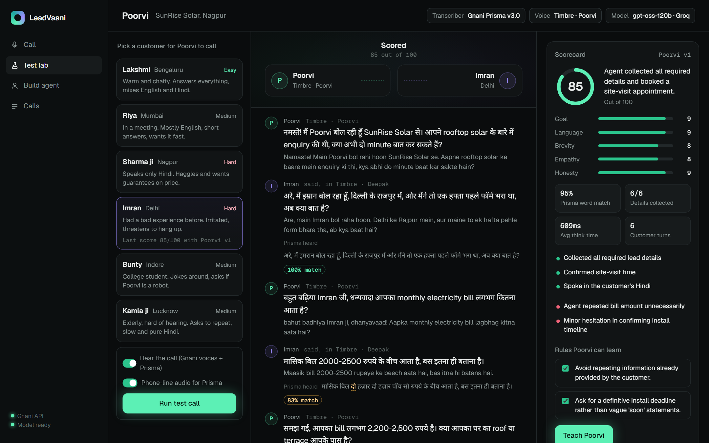
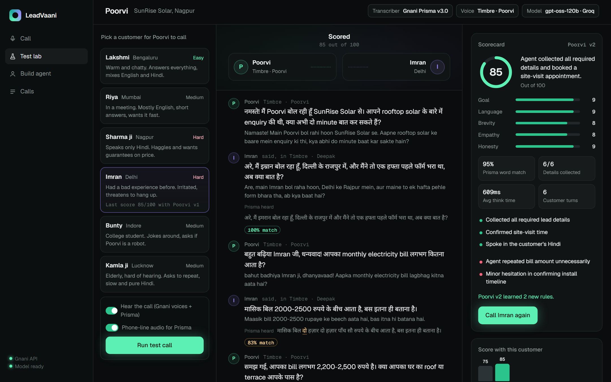
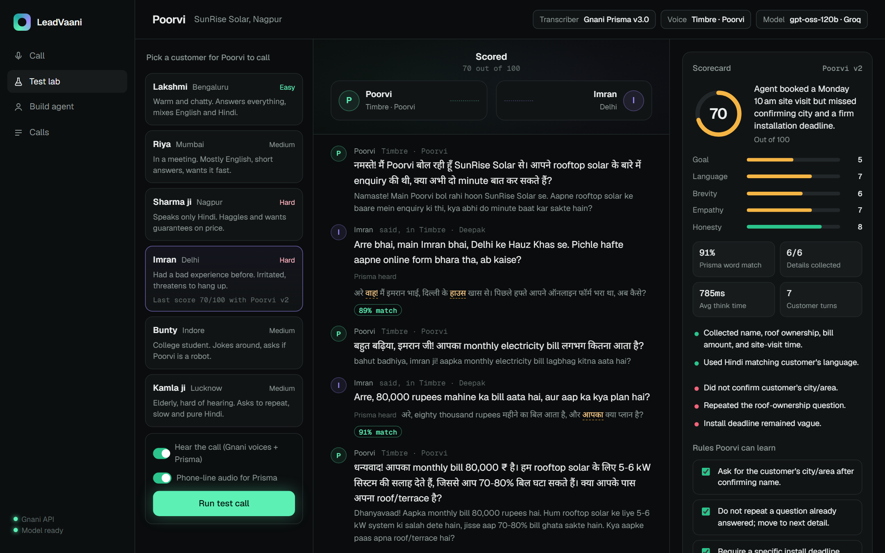
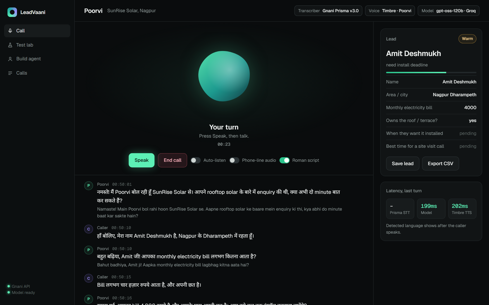
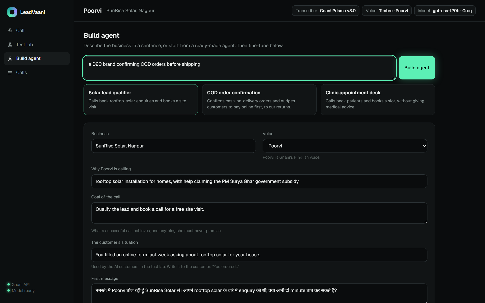
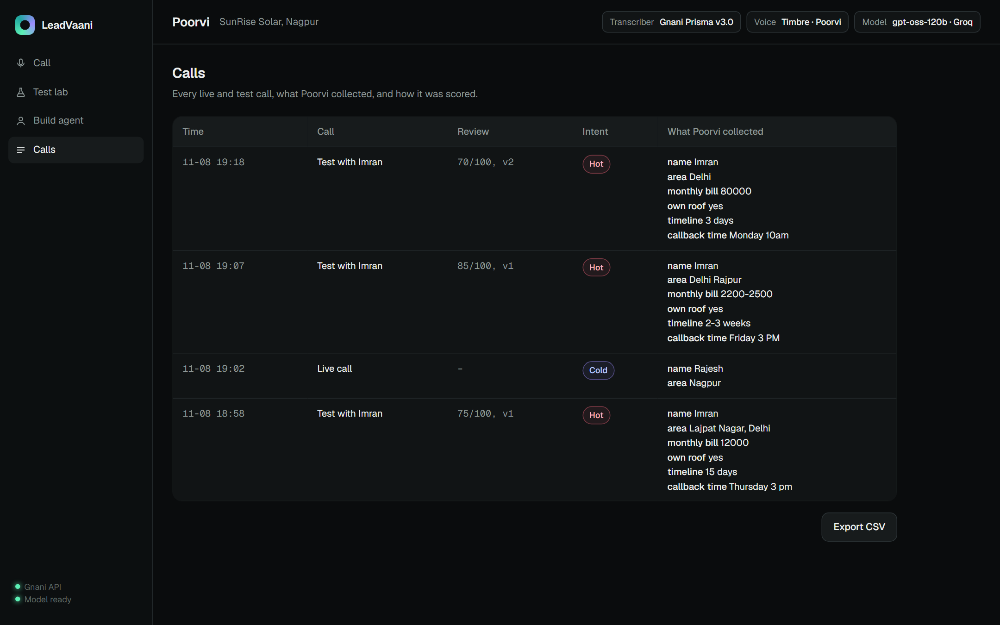

# LeadVaani

**A studio where Hinglish phone agents are built from one sentence, called by AI customers, scored, and taught to do better.** Built on Gnani AI's Prisma v3.0 (speech-to-text) and Timbre v2.5 (text-to-speech) for the Great Indian AI Internship Challenge.

### Try it live: **[leadvaani-sigma.vercel.app](https://leadvaani-sigma.vercel.app)**
**Passcode: `lv-784b6e`** (the page asks once). Open it in Chrome and allow the microphone.



---

## Why

Indian businesses want voice agents that sound like their customers, but most agents are only ever tested by their builder saying "hello?" into a laptop mic. Real callers switch between Hindi and English mid-sentence, are on bad phone lines, get angry, haggle, or mishear. LeadVaani tests an agent against exactly those callers, through the real speech pipeline, and fixes what goes wrong.

The agent is **Poorvi**. She speaks with Gnani's Hinglish voice and can be pointed at any business.

## What you can do on the site

### 1. Test lab: Poorvi calls AI customers

Pick a customer, optionally switch on **phone-line audio**, and press **Run test call**. Poorvi and the customer talk out loud, each in their own Gnani voice.

The whole speech loop is under test, not just the text:
- the customer's line is spoken by **Timbre** in that customer's voice;
- with phone-line audio on, it's squeezed into an 8 kHz, band-limited, hissy line;
- **Prisma** transcribes it back, and Poorvi answers **what Prisma heard**, not the clean text.

Every customer line shows what was said next to what Prisma heard, with a word-match score. The match ignores script and number format, so "mandir" and "मंदिर", or "₹15,000" and "fifteen thousand", count as the same.

| Customer | Gnani voice | Difficulty | How they behave |
|---|---|---|---|
| Lakshmi, Bengaluru | Kaveri | Easy | Warm, chatty, English-heavy Hinglish |
| Riya, Mumbai | Yashvi | Medium | In a meeting, mostly English, wants it quick |
| Sharma ji, Nagpur | Vikrant | Hard | Pure Hindi, haggles, wants price guarantees |
| Imran, Delhi | Deepak | Hard | Bad past experience, threatens to hang up |
| Bunty, Indore | Pranav | Medium | Jokes around, asks if Poorvi is a robot |
| Kamla ji, Lucknow | Nalini | Medium | Elderly, mishears, needs slow, simple Hindi |

### 2. Scorecard and "Teach Poorvi"

When the call ends, a reviewer model reads the transcript and grades it 0–10 on **goal, language match, brevity, empathy and honesty** (no invented prices or promises). It also shows measured numbers: Prisma word match, details collected, think time and turns.

It then suggests rules for the mistakes it saw. Tick them and press **Teach Poorvi**: the rules go into her prompt and she becomes a new version (v1 → v2). Call the same customer again and the chart shows whether she improved.



The AI customers improvise, so no two calls are the same, and a new version doesn't always score higher. In the second call below, Imran claimed an ₹80,000 bill and Poorvi v2 promised "5–6 kW, 70–80% savings", which nobody told her. The reviewer marked her down to 70, caught the invented claim, and suggested the next rules to teach. That loop is the point: every weak spot a test call exposes becomes a rule.



### 3. Live call: talk to Poorvi yourself

Press **Start call** and speak Hindi, English or both. Poorvi replies in Hinglish, fills the lead card on the right as you talk, and shows how long each step took. When you hang up, **Score this call** grades your call the same way.



### 4. Build agent: one sentence in, a whole agent out

Describe a business, for example *"a D2C brand confirming COD orders before shipping"*, and an LLM writes the whole agent: why she's calling, the goal (and what she must never promise), the customer's situation for the test lab, a greeting in Devanagari + English, the details to collect, and keyterms that help Prisma recognise brand names and jargon.

Three ready-made agents are included:
- **SunRise Solar, Nagpur:** rooftop solar lead qualifier;
- **Kurta Kraft:** COD order confirmation for a D2C brand, which cuts RTO returns and nudges customers to pay online first;
- **Sparsh Dental, Pune:** clinic appointment desk.



### 5. Calls

Every live and test call is saved with its transcript, the details collected and a hot / warm / cold score. Export it all as CSV.



---

## How it works

```mermaid
flowchart LR
  subgraph Live call
    M[Your voice] --> P1[Gnani Prisma v3.0<br/>code-mixed STT]
    P1 --> L1[LLM: reply + lead card]
    L1 --> T1[Gnani Timbre v2.5<br/>Poorvi, streamed]
    T1 --> S[Your speaker]
  end
  subgraph Test lab
    C[AI customer LLM] --> T2[Timbre<br/>customer's own voice]
    T2 --> N[8 kHz noisy<br/>phone line]
    N --> P2[Prisma]
    P2 --> L2[Poorvi answers<br/>what Prisma heard]
    L2 --> T3[Timbre: Poorvi]
  end
  T3 --> R[Reviewer LLM:<br/>scores + rules]
  R -->|Teach Poorvi| L1
```

**Prisma** is called with `format=codemix`, Hindi + English, the agent's keyterms, the call's topic and Poorvi's last line as context.

**Speed.** Everything streams so the call feels natural:
- the LLM's reply is streamed, and Timbre starts the moment Poorvi's words are written, before the lead-card fields;
- Timbre's streaming endpoint sends her voice in small pieces that play as they arrive;
- a short filler ("हम्म, ठीक है।") plays the instant you stop talking;
- the greeting audio is made once and cached, so calls start immediately.

Measured on the live site from Nagpur:

| | Before streaming | Now |
|---|---|---|
| Call start (greeting) | ~4 s | 0.6–1.3 s |
| You stop talking → Poorvi's voice starts | 4.7–7 s | **1.1–1.6 s** |
| Prisma transcription | 1–2 s | 0.15–0.45 s |

## Built with

- **Gnani Prisma v3.0** for Hinglish speech-to-text, and **Gnani Timbre v2.5** for Poorvi's voice and the six customer voices.
- **Groq** (`gpt-oss-120b` for Poorvi and the reviewer, `gpt-oss-20b` for the customers) through an OpenAI-compatible API.
- **Vercel**: one Python function in the Mumbai region (`bom1`, next to Gnani), plus **Upstash Redis** for calls, agents, scores and cached audio.
- No frameworks or dependencies: the server is one standard-library Python file (`app.py`) and the UI is one page (`public/index.html`).

## Deploy your own copy on Vercel

1. Fork this repo and run `vercel link` in it.
2. Add Redis: `vercel integration add upstash/upstash-kv --meta primaryRegion=bom1`.
3. Add your keys: `vercel env add GNANI_API_KEY` (from app.gnani.ai → Voice → API Keys) and `vercel env add LLM_API_KEY` (a free Groq key from console.groq.com/keys). Optionally add `APP_PASSCODE` to lock the site.
4. `vercel deploy --prod`.

MIT licence.
